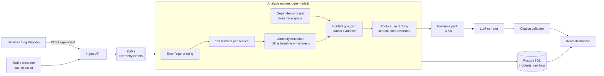

# IncidentLens

**Production incident intelligence: reconstructs what broke, in what order, and why, from distributed service telemetry. An LLM then explains the evidence, but it is not the source of truth.**

When production breaks, an on-call engineer is staring at thousands of log lines from a dozen services and has to answer: *What changed? Which service failed first? Is this one problem or several? What do I look at first?*
IncidentLens answers those questions with a deterministic analysis pipeline, and **measures how often it gets the answer right**.

Java 21 · Spring Boot 4 · Kafka · PostgreSQL · React + TypeScript · Claude API (pluggable, with an offline mock) · Docker

---

## Results

Every scenario below is replayed through the real engine with 10 random seeds, at full, 50% and 25% fault
strength, while **unrelated error bursts hit random services** (about one every 4 minutes). Each run is scored
against the known root cause. This runs as a test in CI (`EvaluationTest`) and fails the build if accuracy drops.

| Method | Top-1 root cause (full) | (50% strength) | (25% strength) | Overall |
|---|---:|---:|---:|---:|
| **IncidentLens ranker** | **96%** | **90%** | **87%** | **91%** |
| Baseline: service with the most errors | 29% | 29% | 29% | 29% |
| Baseline: most recently deployed service | 40% | 40% | 39% | 40% |
| Baseline: service that alerted first | 29% | 29% | 30% | 29% |

- **Detection:** 209 of 210 faults detected; median time to detect **20 seconds** (two 10-second buckets).
- **Top-3:** the true root cause is in the top 3 in 99% of runs.
- Full per-scenario table: `target/evaluation.md` after `./mvnw test`, and in each CI run's summary.

### Scenarios

| Scenario | What happens | Why it's hard |
|---|---|---|
| `payment-db-saturation` | payment-db slows and its pool times out | Errors cascade to order-service and api-gateway, which have *more* errors than the root |
| `inventory-bad-deploy` | v2.3.1 throws NullPointerException | Needs change correlation and new-error detection |
| `email-provider-outage` | External email API returns 503 | Async boundary: orders keep working; only one service is affected |
| `order-pool-misconfig` | Config change shrinks the DB pool | The root sits in the *middle* of the call chain |
| `payment-db-with-decoy-deploy` | Same as the first, plus an unrelated deploy 90s earlier | "Blame the last deploy" gets it wrong |
| `inventory-db-slow` | Latency only, no errors at the source | The root never errors; callers time out |
| `gateway-route-misconfig` | Gateway drops 30% of traffic | Downstream services see *less* traffic, not errors |

**Known weakness:** `gateway-route-misconfig` is the hardest (60–70% top-1). When an unrelated blip hits a
downstream service at the same moment, the two failures look causally connected and the ranker sometimes
blames the downstream service. Telling coincident independent failures apart reliably would need more signal
than error attribution (for example per-route traffic volume).

## How it works



1. **Error fingerprinting.** "Order 8812 failed after 2003ms" and "Order 9120 failed after 1998ms" become one
   group: variable parts are masked, and stack traces are reduced to in-app frames without line numbers. The
   downstream peer is part of the identity, because failed calls to different dependencies share the same
   client stack frames but are different problems.
2. **Anomaly detection.** For each service and 10-second bucket, error rate and p95 latency are compared to the
   previous 5 minutes. A bucket is anomalous only if it clears a statistical threshold (4σ) *and* an absolute
   floor. An anomaly opens after 2 bad buckets in a row and closes after 6 good ones. Anomalous buckets are
   kept out of future baselines, so a long incident never becomes "normal". On a cold start, before any
   baseline exists, an absolute rule applies instead.
3. **Dependency graph.** Inferred from trace context (parent span → child span), plus `peerService` on failing
   calls for components that don't emit telemetry (databases, external APIs).
4. **Incident grouping.** Anomalies join the same incident only with **causal evidence**: the services call
   each other directly *and* the caller's recent errors point at the callee, or both are slow.
5. **Root-cause ranking.** Every affected service is scored on independent factors, and each factor produces a
   human-readable piece of evidence with an ID:

| Factor | Weight | Intuition |
|---|---:|---|
| Started first | 0.20 | Causes precede symptoms |
| Its own dependencies are healthy | 0.25 | Otherwise it may have inherited the failure |
| Explains the other failures | 0.20 | Other affected services fail *on calls toward it* |
| Callers' errors point at it | 0.15 | "84% of order-service errors are failed calls to payment-service" |
| Changed right before | 0.10 | Deploys and config changes in the previous 15 minutes |
| New error signature | 0.10 | Never seen during the baseline period |

When most of the top candidate's errors involve an uninstrumented component, that component is reported as
the **suspected dependency** (e.g. `payment-service / payment-db`).

### The AI layer: controlled, not magic

The LLM never sees raw logs. It receives a bounded **evidence pack** (the ranked hypotheses with evidence IDs
`E1…`, a timeline `T1…`, and the top error signatures `G1…`) and must cite those IDs. Every answer then goes
through a deterministic **validator** that flags:

- citations that don't exist in the evidence pack,
- components that don't appear in the telemetry (hallucinated services),
- answers that never discuss the top-ranked candidate,
- answers with no citations at all.

Warnings are shown next to the answer in the UI. If the provider is down, rate-limited or refuses, the
deterministic analysis is unaffected.

> **Why not just send the logs to an LLM?** It would be expensive (a 20-minute incident at modest traffic is
> ~100k log lines), noisy, and impossible to verify. IncidentLens narrows the incident down deterministically,
> then uses the LLM to explain and answer follow-up questions, never as the source of truth. The evaluation
> above measures the deterministic part, because that is the part that must be right.

Providers: `mock` (default; deterministic template, no key needed), `anthropic` (official Java SDK, default
model `claude-opus-5-5`, server-side refusal fallbacks enabled), `openai` (Chat Completions API).

## Running it

**With Docker:**

```bash
docker compose up --build                      # open http://localhost:8080
LLM_PROVIDER=anthropic LLM_API_KEY=sk-ant-... docker compose up --build   # with Claude
```

**Without Docker** (in-process Postgres and Kafka):

```bash
cd frontend && npm ci && npm run build && cd ..
./mvnw -q test-compile exec:java -Dexec.mainClass=com.incidentlens.LocalDemo -Dexec.classpathScope=test
```

Then wait about 2 minutes while the engine learns a baseline (shown in the top bar), click a scenario under
**Failure injection**, and watch an incident appear about 20 seconds later. Open it, generate the AI summary,
click any `[E3]` citation to jump to the evidence, and click an error signature to see the raw log lines.

### API

| Method | Path | |
|---|---|---|
| `POST` | `/api/ingest/events` | Batch of telemetry events (≤ 10,000) |
| `POST` | `/api/ingest/changes` | Deploy / config / feature-flag change |
| `GET` | `/api/incidents`, `/api/incidents/{id}` | Incidents; full report with candidates, evidence, timeline, error groups, graph |
| `POST` | `/api/incidents/{id}/investigate` | LLM summary (validated) |
| `POST` | `/api/incidents/{id}/ask` | Follow-up question `{"question": "..."}` |
| `GET` | `/api/services`, `/api/graph`, `/api/error-groups`, `/api/logs` | Live health, dependency graph, error groups, raw log search |
| `POST` | `/api/simulator/scenarios/{name}?minutes=5` | Inject a failure (demo mode) |

## Testing

```bash
./mvnw verify
```

- `EvaluationTest`: the 210-run accuracy gate above (about 1 minute).
- `EndToEndTest`: posts 20 minutes of simulated traffic through the HTTP API → Kafka → engine → Postgres, then
  checks the incident, ranking, AI investigation (validated, no warnings), follow-up Q&A, and log drill-down.
  It uses real Postgres and Kafka running in-process, so it needs no Docker.
- `IncidentEngineTest`, `FingerprinterTest`, `AnswerValidatorTest`: unit-level behaviour.

## Bugs the evaluation and the live demo found

These are worth more in an interview than the features:

- **Over-eager grouping.** Grouping anomalies by "connected in the call graph" merged unrelated noise blips
  into real incidents, because in a small system everything is within 3 hops. Once noise was added to the
  evaluation, top-1 accuracy was 54%. Only joining incidents that are still actively failing, and then
  requiring *causal evidence* (a direct call plus error attribution), raised it to 82%.
- **Latency-only failures were invisible to attribution.** A slow database makes callers slow, not
  error-prone, so "callers' errors blame it" had nothing to go on. Shared latency anomalies across a direct
  call now count as evidence (82% → 85%).
- **The evaluation harness had bugs too.** It matched faults to incidents by start time, so a fault that
  extended an already-open noise anomaly counted as "not detected", and detection time showed a misleading 0s.
  Matching on anomalies *active during* the fault fixed both (85% → 89%), without touching the engine.
- **Cold-start blindness.** In the live demo, a failure injected while the engine was still learning its
  baseline was absorbed *into* the baseline, and 33% errors became "normal". An absolute rule now applies until
  a baseline exists. This also raised evaluation accuracy from 89% to 91%, because noise during warm-up had
  been polluting baselines.
- **Fingerprints merged different problems.** Failed calls to inventory-service and payment-service share the
  same HTTP-client stack frames, so they collapsed into one error group with a misleading sample message. The
  peer is now part of the fingerprint.

## Project layout

```
src/main/java/com/incidentlens
├── engine/       Fingerprinter, buckets, anomaly tracking, dependency graph, incidents, RootCauseRanker
├── simulator/    Topology, traffic generator, fault scenarios, live runner
├── evaluation/   Evaluator + report (also runnable: java ... Evaluator)
├── ai/           LLM clients (Anthropic SDK, OpenAI, mock), evidence pack, prompts, validator
├── ingest/       HTTP → Kafka publisher, Kafka consumer
├── store/        Postgres: raw logs, incident snapshots, investigations
└── api/          REST controllers
frontend/         React + TypeScript dashboard (Vite)
```

## Limitations and next steps

- One analyzer instance holds the engine state in memory. Scaling out would mean partitioning by service
  cluster (or a shared state store) and checkpointing engine state.
- Telemetry uses a simple JSON schema modelled on OpenTelemetry fields; an OTLP receiver would make it a
  drop-in for real services.
- Metrics (CPU, saturation, queue depth) would add signals for faults that produce neither errors nor latency.
- Ranking weights are hand-set; with more labelled incidents they could be fitted against the evaluation set.
